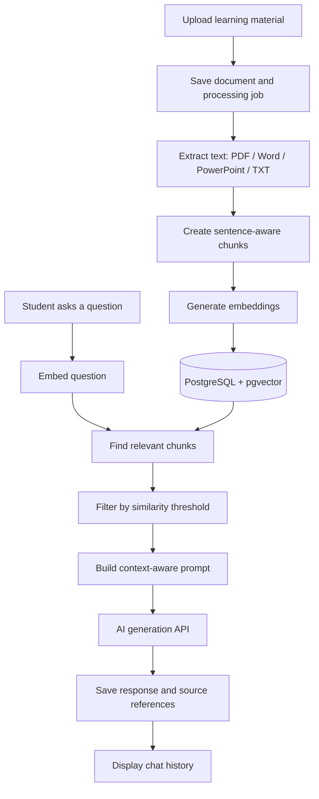

<div align="center">

# AI Knowledge Hub

### Learn from your own materials, with AI-powered answers and relevant source context.

A document-aware learning platform built with **Java, Spring Boot, PostgreSQL, pgvector, and OpenAI**. Upload study materials, turn them into searchable knowledge, and ask questions through a persistent chat interface.


[Features](#features) · [How it works](#how-it-works) · [Tech stack](#tech-stack) · [Getting started](#getting-started) · [API](#api-overview) · [Testing](#testing)

</div>

> **Project status:** This repository represents a working implementation of document ingestion, vector indexing, persistent chats, account management, and administrative monitoring. **The AI chat integration needs migration**: the checked-in `OpenAiClient` uses OpenAI's Assistants API, which was retired on August 26, 2026. The Responses API is its recommended replacement. Consequently, this revision is a **development prototype**, not a plug-and-play production deployment. See [Current limitations](#current-limitations).

## Overview

**AI Knowledge Hub** explores a practical use of **retrieval-augmented generation (RAG)** in education. Instead of treating every question as an isolated prompt, the application retrieves relevant passages from an uploaded document and supplies them as context when requesting an AI-generated answer.

The goal is to make studying from personal notes, PDFs, presentations, and text documents more interactive while preserving links between answers and their supporting source passages.

The current application is a server-rendered Spring Boot web app with a companion REST API. Each chat is associated with an uploaded document, and conversation history is stored in PostgreSQL.

## Features

- **Document-based conversations** — create chats from uploaded study materials and return to previous conversations.
- **Multiple document formats** — extract text from PDF, DOC, DOCX, PPT, PPTX, and TXT files using Apache PDFBox and Apache POI.
- **Semantic document indexing** — divide extracted text into sentence-aware chunks, generate embeddings, and store them with `pgvector`.
- **Relevant-context retrieval** — retrieve the top matching chunks for a question using vector similarity, with configurable `top-k` and similarity threshold.
- **Source-context tracking** — store the document chunks associated with generated responses so they can be displayed alongside messages.
- **Background document processing** — run extraction and indexing asynchronously and track processing stages and failures.
- **Progress notifications** — use Spring WebSocket/STOMP and SockJS for document-processing events.
- **User accounts** — registration, email verification, login, profile settings, password changes, and account deactivation/reactivation.
- **Administration** — monitor processing jobs, failed uploads, users, chats, and stored vector counts.
- **Internationalization** — message bundles for English, Bulgarian, German, Spanish, and French.
- **Automated testing** — unit and integration test suites for controllers, services, utilities, and validation.
- **Container deployment configuration** — Dockerfile and GitHub Actions workflow for Azure Container Apps.

## How it works



### Retrieval pipeline

1. **Ingest:** upload a document; its metadata and original bytes are stored in the database.
2. **Parse:** extract the text with a format-specific parser.
3. **Chunk:** create sentence-aware segments targeting roughly **800 characters** (long individual sentences may exceed the target).
4. **Embed and store:** generate a vector for each segment and persist it in the `document_chunks` table.
5. **Search:** embed the user's question and query pgvector using cosine distance (`<=>`), scoped to the chat's document.
6. **Generate:** include relevant passages in the prompt sent to the AI provider.
7. **Persist:** save the exchange, the conversation identifier, and references to supporting chunks.

The checked-in implementation uses **Spring AI's local transformer embedding support** for indexing and search. AI answer generation is implemented with a legacy OpenAI Assistants/Threads client, which must be migrated before it can be used again.

## Tech stack

| Layer | Technologies |
| --- | --- |
| Language and runtime | Java 17 |
| Backend | Spring Boot 3.3.0, Spring MVC, Spring Data JPA, Spring Security, Bean Validation |
| AI and retrieval | Spring AI, local transformer embeddings, OpenAI API integration (legacy Assistants API) |
| Storage | PostgreSQL, pgvector, Hibernate Vector |
| Document parsing | Apache PDFBox, Apache POI |
| Frontend | Thymeleaf, HTML, CSS, JavaScript |
| Real-time events | Spring WebSocket, STOMP, SockJS |
| Build and testing | Gradle, JUnit 5, Spring Boot Test, Mockito, H2, Awaitility |
| Deployment configuration | Docker, GitHub Actions, Azure Container Registry, Azure Container Apps |

## Project structure

```text
AI-Knowledge-Hub/
├── src/
│   ├── main/
│   │   ├── java/org/example/
│   │   │   ├── clients/          # OpenAI integration
│   │   │   ├── configurations/   # Security, async, i18n, WebSocket
│   │   │   ├── controllers/      # Web MVC and REST endpoints
│   │   │   ├── models/           # Entities and DTOs
│   │   │   ├── repositories/     # Persistence and vector search
│   │   │   ├── services/         # Business logic and processing
│   │   │   ├── aop/              # Processing notifications
│   │   │   └── utils/            # Document and text utilities
│   │   └── resources/
│   │       ├── templates/        # Thymeleaf views
│   │       ├── static/           # CSS, JavaScript, images
│   │       ├── i18n/             # Translation bundles
│   │       ├── schema.sql       # pgvector extension
│   │       └── application.yml
│   └── test/                     # Unit and integration tests
├── .github/workflows/deploy.yml
├── Dockerfile
├── build.gradle
└── gradlew / gradlew.bat
```

## Getting started

> These steps prepare the local infrastructure and application. **AI-generated replies will not work in this checked-in revision** until its retired Assistants API calls have been migrated. The email-verification base URL is also currently hard-coded for an Azure deployment.

### Prerequisites

- **JDK 17**
- **PostgreSQL** with the **pgvector** extension (or a compatible pgvector Docker image)
- An SMTP account for registration emails
- OpenAI API credentials **after** migrating the legacy chat client
- Git; Gradle does not need to be installed globally because the wrapper is included

### 1. Clone the repository

```bash
git clone https://github.com/RosenTodorov2006/AI-Knowledge-Hub.git
cd AI-Knowledge-Hub
```

### 2. Start PostgreSQL with pgvector

For a local Docker-based database (example):

```bash
docker run --name ai-knowledge-db \
  -e POSTGRES_DB=ai_knowledge_hub_db \
  -e POSTGRES_USER=postgres \
  -e POSTGRES_PASSWORD=change-me \
  -p 5435:5432 \
  -d pgvector/pgvector:pg16
```

The application runs `CREATE EXTENSION IF NOT EXISTS vector;` from `schema.sql` during initialization. The database user must have permission to create the extension.

### 3. Configure the application

The checked-in `application.yml` defaults to port `8080` and expects these application properties. Supply environment variables or configuration overrides; **do not commit real API keys, database passwords, or SMTP credentials**.

| Environment variable | Purpose |
| --- | --- |
| `SPRING_DATASOURCE_URL` | PostgreSQL JDBC URL (example: `jdbc:postgresql://localhost:5435/ai_knowledge_hub_db`) |
| `SPRING_DATASOURCE_USERNAME` | Database user |
| `SPRING_DATASOURCE_PASSWORD` | Database password |
| `SPRING_MAIL_USERNAME` / `SPRING_MAIL_PASSWORD` | SMTP authentication |
| `SPRING_AI_OPENAI_API_KEY` | OpenAI API key (required by current configuration) |
| `APP_OPENAI_ASSISTANT_ID` | **Legacy setting**; to be removed/replaced during Responses API migration |
| `APP_OPENAI_POLLING_INTERVAL` | Legacy run-polling interval in milliseconds |
| `APP_ASYNC_CORE_POOL_SIZE` | Document-processing executor core size |
| `APP_ASYNC_MAX_POOL_SIZE` | Document-processing executor maximum size |
| `APP_ASYNC_QUEUE_CAPACITY` | Document-processing executor queue size |
| `APP_CHAT_TOP_K` | Maximum number of retrieved chunks |
| `APP_CHAT_SIMILARITY_THRESHOLD` | Minimum accepted similarity score |

Example values for the non-secret tuning settings:

```bash
export APP_ASYNC_CORE_POOL_SIZE=5
export APP_ASYNC_MAX_POOL_SIZE=10
export APP_ASYNC_QUEUE_CAPACITY=500
export APP_CHAT_TOP_K=5
export APP_CHAT_SIMILARITY_THRESHOLD=0.65
export APP_OPENAI_POLLING_INTERVAL=1500
```

Set the database credentials, mail credentials, API key and legacy assistant setting separately in your environment. For **local email verification**, update the hard-coded registration-link base URL in [`EmailServiceImpl`](src/main/java/org/example/services/impl/EmailServiceImpl.java) before using the registration flow.

### 4. Build and start

**macOS / Linux:**

```bash
./gradlew bootRun
```

**Windows:**

```powershell
.\gradlew.bat bootRun
```

Open **http://localhost:8080**. Registration, email verification, and document processing require their dependent services to be configured correctly. Java/Spring AI model dependencies may download model artifacts on first startup.

## API overview

The codebase exposes REST endpoints alongside the Thymeleaf UI:

| Method | Endpoint | Purpose |
| --- | --- | --- |
| `GET` | `/api/chats/dashboard` | Get chat dashboard data |
| `POST` | `/api/chats/create` | Upload a file and create a chat (`multipart/form-data`, field: `file`) |
| `GET` | `/api/chats/{id}` | Fetch one chat and its messages |
| `POST` | `/api/chats/{id}/send` | Submit a message (form field: `message`) |
| `DELETE` | `/api/chats/{id}` | Delete a chat |
| `GET` | `/api/admin/stats` | Read administrator statistics |
| `GET` | `/api/admin/failed-jobs` | List failed processing jobs |
| `GET` | `/api/admin/monitor-data` | Read monitoring dashboard data |
| `GET` | `/api/settings` | Fetch account settings data |

Some endpoints depend on the authenticated user's `Principal`. **The current security configuration needs review before exposing these endpoints publicly**; this table describes the implementation, not a production-safe API contract.

## Testing

The repository contains unit tests and Spring integration tests covering key controllers, service implementations, configuration, validators, document utilities, and the AI client.

```bash
# macOS / Linux
./gradlew test

# Windows
.\gradlew.bat test
```

Tests use a dedicated configuration in `src/test/resources/application-test.properties`, including an H2 test database. **Test execution has not been verified as part of this README review.**

## Deployment

The repository includes a Dockerfile and a GitHub Actions workflow that builds the Spring Boot JAR, creates and pushes a container image to Azure Container Registry, and updates an Azure Container App on pushes to `main`.

This is **deployment configuration**, not a guarantee that the hosted application is currently live. The workflow depends on Azure resources and an `AZURE_CREDENTIALS` GitHub secret. Before deploying, migrate the AI API client, externalize environment-specific values and secrets, and complete a security review.

## Current limitations

- **Required API migration:** [`OpenAiClient`](src/main/java/org/example/clients/OpenAiClient.java) still calls the retired OpenAI Assistants API. Move the chat integration to the [Responses API](https://developers.openai.com/api/docs/assistants/migration) before relying on AI responses.
- **Security hardening needed:** review API route authorization, access to user-owned chats, CSRF protection, upload validation, and handling of environment-specific credentials before public deployment.
- **Environment-specific configuration:** the current email verification URL is hard-coded, and local database defaults are tailored to the original development environment.
- **Document extraction scope:** text-based extraction is implemented; OCR for scanned/image-only documents is not part of this repository's current pipeline.
- **No performance guarantees:** indexing is performed chunk by chunk; large-document throughput and scalability have not been benchmarked here.

## Roadmap

Potential next steps, **not claims of completed functionality**:

- [ ] Migrate chat generation to OpenAI's Responses API
- [ ] Strengthen authorization and add API-level ownership tests
- [ ] Move deployment-specific settings into environment-based configuration
- [ ] Add OCR support for scanned study materials
- [ ] Improve indexing throughput and observability for large documents
- [ ] Add deployment/demo screenshots and a short walkthrough

## Author

Built by **[Rosen Todorov](https://github.com/RosenTodorov2006)** as a Java/Spring Boot project exploring document processing, vector search, and AI-assisted learning.

---

*AI Knowledge Hub is an evolving portfolio project. This README documents the code currently present in the repository rather than unreleased features.*
